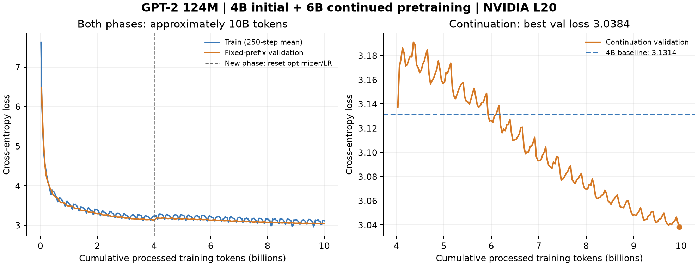

# GPT-2 from scratch: training lab

A hands-on GPT-2 implementation following Andrej Karpathy's [Let's reproduce GPT-2 (124M)](https://www.youtube.com/watch?v=l8pRSuU81PU) and [build-nanogpt](https://github.com/karpathy/build-nanogpt).

Train on bundled Tiny Shakespeare or tokenized FineWeb(-Edu) shards, save checkpoints, and resume at the next optimizer step. The Transformer definition remains the original learning implementation. See [the implementation walkthrough](docs/fineweb-resume.md) for the new runtime changes.

Once you have a base checkpoint, follow the [SFT learning guide](docs/sft.md) to
prepare short English conversations, fine-tune on assistant answers, and chat with
the result. This separate single-GPU path reuses the original GPT-2 model and tokenizer.

## Recorded experiments

The lab has completed a 4B-token pretraining run, a separate 6B-token continuation
phase, and several exploratory SFT runs on one NVIDIA L20. These are educational
experiments with a **124,475,904-parameter model**, not a claim of a reliable chat
assistant or an exact reproduction of Karpathy's uninterrupted 10B run.

| Pretraining checkpoint | Validation loss | Perplexity | Training time |
|---|---:|---:|---|
| 4B phase | 3.2008 | 24.55 | 11h 58m |
| Approximately 10B, selected best | 3.1079 | 22.37 | A further 17h 56m |

Both checkpoints were evaluated on the same **2,097,152 held-out tokens**, not the
entire 100M-token validation shard. The continuation completed approximately 10B
cumulative processed tokens; its selected best checkpoint was saved at about
**9.964B**. The two phases used different schedules and a fresh optimizer at the
phase boundary.



The latest 20,000-example SFT experiment improved strict short-task performance
on a newly frozen test set, but arithmetic and open-ended answers remain weak:

| SFT variant | Strict programmatic tasks | Natural held-out reference loss |
|---|---:|---:|
| Initial mixed SFT, 10k examples | 0/256 | 1.8404 |
| Focused short-task SFT, 4,871 examples | 67/256 (26.2%) | 2.0245 |
| Expanded SFT, 20k examples | 139/256 (54.3%) | 1.6694 |

Strict scoring includes the requested output format; it is **not general QA
accuracy**. The expanded model still scored 0/32 on addition and 1/32 on
subtraction in the answer-only test. Open-ended outputs can repeat, ignore
instructions or invent facts. See [experiment details and limitations](docs/training-results.md),
[machine-readable metrics](docs/experiment-metrics.json), and
[unedited SFT samples](docs/sft20k-samples.json).

## Model artifacts

Check [GitHub Releases](https://github.com/lele94218/gpt2-from-scratch/releases)
for published model attachments. Weights are kept outside Git history. Release
notes identify the exact artifacts and their checksums; a local training run or
backup does not automatically make a checkpoint downloadable.

The repository's `.pt` format works with `generate.py` for base-model completion
and `chat.py` for SFT conversation. It is not a Hugging Face Transformers export.

To prepare a smaller, weights-only release file from a **trusted** checkpoint:

```bash
python export_weights.py --checkpoint checkpoints/experiment/best.pt \
  --output checkpoints/releases/model-weights.pt
```

The exporter preserves model tensors and configuration, verifies the result, and
removes optimizer/RNG/data-cursor state. Such an artifact supports inference and
`--init-from`, but **cannot be used with `--resume`**. Keep the original full
checkpoint if exact training-state recovery is needed.

## Install on a Linux NVIDIA GPU machine

Requirements: Git, internet access, a BF16-capable NVIDIA GPU and a compatible driver. The setup uses [uv](https://docs.astral.sh/uv/getting-started/installation/) and Python 3.12; it never changes host drivers.

```bash
git clone https://github.com/lele94218/gpt2-from-scratch.git
cd gpt2-from-scratch
curl -LsSf https://astral.sh/uv/install.sh | sh
export PATH="$HOME/.local/bin:$PATH"
bash setup.sh cu118
source .venv/bin/activate
```

`cu118` installs PyTorch 2.6.0/CUDA 11.8 as a compatibility choice for older drivers, such as the A10 host's 535 branch. `bash setup.sh cu128` selects the original training machine's PyTorch 2.11.0/CUDA 12.8 profile, requiring a newer compatible driver. Follow the [official wheel matrix](https://pytorch.org/get-started/previous-versions/); the CUDA field in `nvidia-smi` is not `torch.version.cuda`. The exact A10 environment has not been tested.

Attention uses PyTorch SDPA; no separate flash-attn installation is required. First use downloads tokenizer assets and compiles kernels. Do not count compilation time as steady-state throughput.

## Quick run: bundled Shakespeare

```bash
python train-gpt2.py --max-steps 5 --output-dir checkpoints/shakespeare
```

This writes `checkpoints/shakespeare/latest.pt` after the final optimizer update, before generating text. By default, a longer run also saves every 100 updates. An existing checkpoint is never silently replaced by a fresh run: use `--resume` or another output directory.

```bash
# DDP path on one GPU
torchrun --standalone --nproc_per_node=1 train-gpt2.py \
  --max-steps 5 --output-dir checkpoints/ddp1

# Same-machine two-GPU training
torchrun --standalone --nproc_per_node=2 train-gpt2.py \
  --max-steps 5 --output-dir checkpoints/ddp2
```

## Download pretokenized FineWeb-Edu (recommended for training)

Use [Karpathy's GPT-2 token shards](https://huggingface.co/datasets/karpathy/fineweb-edu-100B-gpt2-token-shards) without running tokenization:

```bash
uv pip install --python .venv/bin/python -r requirements-tokens.txt

# Pilot: 100M training tokens + 100M validation tokens.
python prepare_fineweb_tokens.py --train-shards 1 --output-dir data/fineweb-pretokenized-pilot

# 10B training tokens + 100M validation tokens.
python prepare_fineweb_tokens.py --train-shards 100 --output-dir data/fineweb-pretokenized-10B
```

Point training at `--data-dir data/fineweb-pretokenized-10B` and omit `--input-file`. The script pins the dataset revision, downloads training shards 1–100 and validation shard 0, checks llm.c GPT-2 headers, file sizes and token IDs, and preserves the token IDs in `.npy` format. It publishes the loader's SHA-256 manifest only after all selected shards pass.

Re-run the same command after interruption. Downloads are reused, existing NPY contents are compared against the source before being skipped, and partial `.tmp` outputs are replaced. A `.preparation.json` records the selection; use a new output directory to change the shard count or revision. The BIN cache can be shared. Completed outputs from the earlier manual conversion commands are accepted if their source revision and file selection match. Do not prepare/reverify a directory during training, or run concurrent preparations into it.

Raw and converted data occupy about **40.4 GB** for this selection; leave at least 50 GB free for preparation, plus space for your environment and checkpoints. `--cache-dir` defaults to `data/fineweb-bin-cache`. Conversion uses CPU and bounded chunks/memory maps; it requires no GPU, PyTorch or tokenizer. Downloading on a rented GPU instance still incurs applicable instance and bandwidth costs.

This selects 10B from the **100B pretokenized corpus**; it is not guaranteed to match `sample-10BT` documents/order. Validation stays separate. Do not download the full 100B repository for this run. The source is ODC-By; retain attribution to HuggingFaceFW/FineWeb-Edu and Karpathy's token-shard repository. The binary format is defined by [llm.c's writer](https://github.com/karpathy/llm.c/blob/master/dev/data/data_common.py).

## Prepare FineWeb-Edu from raw text (optional)

```bash
uv pip install --python .venv/bin/python -r requirements-data.txt

# Small pilot: 3 million GPT-2 tokens, including a 1-million-token validation shard.
python prepare_fineweb.py --output-dir data/fineweb-pilot \
  --shard-size 1000000 --max-tokens 3000000

python train-gpt2.py --data-dir data/fineweb-pilot \
  --max-steps 20 --checkpoint-every 5 --output-dir checkpoints/fineweb-pilot
```

The default source is [HuggingFaceFW/fineweb-edu](https://huggingface.co/datasets/HuggingFaceFW/fineweb-edu), configuration `sample-10BT`, streamed without downloading the entire source first. For ordinary FineWeb, select `--dataset HuggingFaceFW/fineweb`. Use `--revision <dataset-commit>` to pin the input snapshot.

For the full source configuration, omit `--max-tokens`:

```bash
python prepare_fineweb.py --output-dir data/fineweb-edu --shard-size 100000000
```

Preparation uses one tokenizer process for clarity. Memory is bounded by one shard plus the current document; large-scale preprocessing will take time. GPT-2 tokenization may produce a different token count from the source dataset's advertised count. uint16 storage uses roughly two bytes per token, plus headers; reserve sufficient disk space before processing billions of tokens.

The first shard is held out as validation data. Validation-loss evaluation is available as described below; HellaSwag is not implemented. All training reads only `train` entries in `manifest.json`. An interrupted preparation has no completed manifest; retry into an empty directory. Preparation itself is not resumable.

Dataset attribution: FineWeb/FineWeb-Edu are published by HuggingFaceFW under ODC-By; see their dataset cards for attribution and use conditions. No FineWeb data or model checkpoints are committed here.

## Generate text from an existing checkpoint

For a base model, supply a raw text prefix to continue:

```bash
python generate.py --checkpoint checkpoints/experiment/best.pt \
  --prompt "Once upon a time, in a small village," \
  --max-new-tokens 128 --temperature 0.8 --top-k 50 --seed 42
```

Use your saved `latest.pt` if the run has no `best.pt`. `--temperature 0` selects
greedy decoding. Generation stops at the end-of-text token, the requested length,
or the model's 1024-token context limit. `--device auto` uses CUDA when available;
`--device cpu` is also supported. For role-formatted SFT conversation, use `chat.py`.

## Evaluate an existing checkpoint

No retraining is needed. Model dimensions are read from the checkpoint; optimizer and training cursors are not restored or updated. Existing format-version-1 checkpoints remain compatible.

```bash
python eval-gpt2.py --checkpoint checkpoints/gpt2-fineweb-10B/latest.pt \
  --data-dir data/fineweb-pretokenized-10B --device cuda \
  --batch-size 4 --seq-len 1024 --max-batches 20

# Two GPUs evaluate the same global sample, partitioned between ranks.
torchrun --standalone --nproc_per_node=2 eval-gpt2.py \
  --checkpoint checkpoints/gpt2-fineweb-10B/latest.pt \
  --data-dir data/fineweb-pretokenized-10B --device cuda --max-batches 20
```

Only `val` entries are loaded and checksum-verified. Training shard files need not be present. Use `--device cpu` or explicitly `--device mps` for standalone Mac evaluation; `auto` selects CUDA when available, otherwise CPU. CUDA uses BF16 autocast, CPU/MPS FP32, so values across these devices need not match exactly.

The default evaluates **20 global batches (81,920 target tokens at B=4, T=1024)**, a quick sample rather than the full 100M-token validation shard. `--max-batches 0` evaluates every complete sequence once. Partial final batches are included; each shard's trailing incomplete sequence is omitted. Sequences do not cross shard boundaries. There is no wraparound or duplication to meet a batch limit. Reported loss is summed token negative log-likelihood divided by evaluated token count; perplexity is exp(loss). Output includes the checkpoint step, token count and evaluation settings. DDP reduces summed loss and token count, including ranks with no assigned batches.

To validate during training, add:

```bash
python train-gpt2.py --data-dir data/fineweb-pretokenized-10B \
  --max-steps 19073 --warmup-steps 715 --no-generate \
  --eval-every 250 --eval-batches 20 --output-dir checkpoints/with-validation
```

`--eval-every 250` evaluates after every 250 updates and at normal exit. `--eval-every 0` (default) keeps evaluation off, including text-only runs. `--eval-batches 0` requests the full validation split. Every evaluation restarts from the same validation prefix, preserves RNG state and restores training mode. It uses a separate data source and never advances the training cursor or updates parameters. These evaluation settings may be changed on resume without changing the checkpoint format or LR horizon. Training checkpoints are saved before a coincident evaluation; evaluation time is excluded from the printed training-step throughput.

## Save and resume correctly

If a completed run needs **additional data and a new training schedule**, use
`--init-from` to start a new phase from its model weights. This resets the optimizer
and data cursor; `--resume` retains their state and requires unchanged settings.
See [continued pretraining](docs/continued-pretraining.md) for a 4B → 10B workflow,
training-shard ranges, offline source verification and checkpoint provenance.

Keep the LR horizon fixed across interruption. `--max-steps` is the total intended training horizon, while `--stop-after` is an absolute completed-step count for a planned pause:

```bash
# Plan 100 steps, pause after completing step indices 0..9.
python train-gpt2.py --data-dir data/fineweb-pilot \
  --max-steps 100 --stop-after 10 --checkpoint-every 5 \
  --output-dir checkpoints/experiment

# Continue from step index 10 with the SAME training settings.
python train-gpt2.py --data-dir data/fineweb-pilot \
  --max-steps 100 --checkpoint-every 5 \
  --output-dir checkpoints/experiment --resume checkpoints/experiment/latest.pt
```

For DDP, launch resume with the same `torchrun --nproc_per_node=N` and settings. All ranks participate in checkpoint coordination; rank zero atomically replaces `latest.pt`. Every rank must be able to read the same checkpoint and data. Multi-node orchestration is outside the tested scope.

A checkpoint contains model weights, AdamW state, the next step, per-rank data cursors and Python/NumPy/PyTorch CPU/CUDA RNG states. The loader verifies shard content hashes on startup (a full sequential disk scan) and validates the dataset fingerprint on restore. A relocated copy with identical filenames/content is allowed.

Resume rejects changes to world size, batch shape, model shape, LR horizon, seed, optimizer settings, precision, compile mode or PyTorch version. Dataset content must match. This is continuation, not elastic rescaling or fine-tuning. Exact floating-point equality across different hardware/software is not promised.

Checkpoints are saved only at completed optimizer steps. Abrupt termination loses work after the most recent successful save; restart with `--resume`. Only `latest.pt` is retained; copy it elsewhere if you need history. Each GPT-2/AdamW checkpoint can occupy roughly 1.5 GB, and atomic replacement temporarily needs space for both the old and new file. Checkpoint time is excluded from the printed training-step throughput.

Load only your own trusted checkpoints: `torch.load(..., weights_only=False)` is used to restore Python/NumPy RNG objects.

## Configuration

Run `python train-gpt2.py --help` for all flags.

| Setting | Default |
|---|---:|
| Layers / heads / embedding width | 12 / 12 / 768 |
| Vocabulary / parameters | 50,304 / 124,475,904 |
| `--batch-size` / `--seq-len` | 4 / 1,024 |
| `--total-batch-size` (global tokens/update) | 524,288 |
| `--max-steps` / `--warmup-steps` | 30 / 10 |
| `--checkpoint-every` | 100, plus normal exit |
| `--compile` / `--generate` | enabled |
| CUDA precision | BF16 autocast |

Global batch must be divisible by batch-size × seq-len × world-size. The original single-GPU defaults accumulate 128 micro-batches. Small Shakespeare data repeats within an update: these defaults demonstrate training infrastructure, not an optimal small-data recipe.

`--no-compile` avoids compilation for debugging. `--no-generate` skips post-training sampling. Explicit `--device cpu` uses FP32 and supports lightweight Gloo tests; the documented performance target remains NVIDIA CUDA. Model dimensions can be reduced with `--n-layer`, `--n-head`, `--n-embd` for tests. MPS is not a supported training target in this runtime.

## Tests

For full GPT-2 124M acceptance on a rented two-GPU host, follow the [GPU test manual](docs/gpu-test-manual.md): single-rank entry-point comparison, real FineWeb shards, and two-rank uninterrupted versus resumed training with exact checkpoint checks.

Offline tests use synthetic documents, tiny model dimensions and no Hugging Face downloads beyond the GPT-2 tokenizer's first-use assets:

```bash
python -m unittest discover -s tests -v
```

They check documents spanning multiple shards, token caps, DDP rank boundaries, data corruption, RNG restoration, and uninterrupted versus interrupted/resumed training. CPU tests run both single process and two-rank Gloo and compare loss/LR sequences, final parameters, optimizer state and loader/RNG state exactly.

Optional CUDA/NCCL regression (one GPU):

```bash
TEST_DEVICE=cuda TEST_WORLDS=1 TEST_TORCHRUN=1 \
  python -m unittest discover -s tests -v
```

Set `TEST_COMPILE=1` to exercise the compiled training path. Tests use disposable directories and do not overwrite real checkpoints. Runtime validation results and limitations are recorded in the PR.

## Attribution

The bundled [Tiny Shakespeare](https://github.com/karpathy/char-rnn/blob/master/data/tinyshakespeare/input.txt) comes from char-rnn. Based on Karpathy's teaching material and GPT-2 implementation patterns; the MIT notice from [nanoGPT](https://github.com/karpathy/nanoGPT/blob/master/LICENSE) is retained in `LICENSE`.
